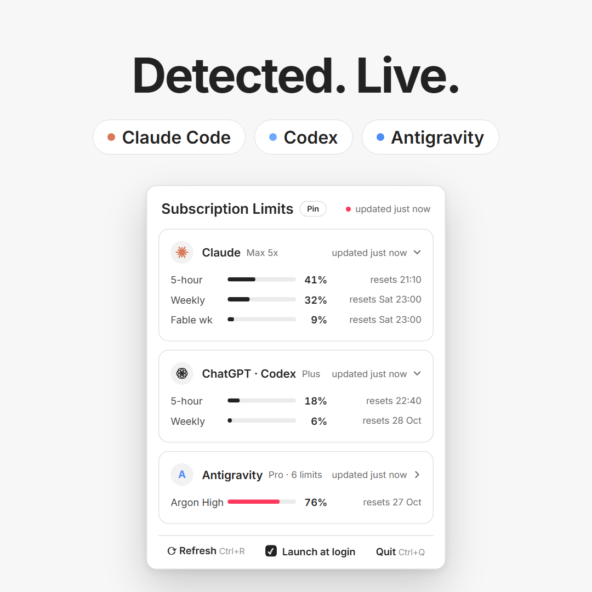

# limitbar

[](https://github.com/BoboFr/limitbar/actions/workflows/ci.yml)

**Your AI subscription limits, one click from the Windows 11 clock.**

limitbar is a tiny native tray widget written in Rust. It finds the AI tools
installed and logged in on your PC — **Claude Code**, **Codex** and
**Google Antigravity** — and shows their live usage limits: 5-hour session,
weekly, per-model quotas and when each one resets.

<p align="center">
  
</p>

▶ [Watch the 18-second demo](assets/limitbar-demo.mp4)

## Features

- **Lives in the notification area** — the tray icon is a mini bar chart, one bar per tool. Left-click opens the popup above the taskbar, right-click shows a menu.
- **Zero configuration** — detects what is installed and logged in, hides what isn't.
- **Live numbers** — read from the same sources the tools use themselves, refreshed every 5 minutes and on demand.
- **Per-model detail** — model variants (Low / Medium / High…) are grouped under their model.
- **Early warning** — bars turn red-pink at 70 % and red at 90 %.
- **Collapsible cards** — large cards start collapsed to their most-used limit; the state is remembered.
- **Pin, launch at login, shortcuts** — `Ctrl+R` refresh, `Ctrl+Q` quit, `Esc` close.
- **Light and native** — one ~4 MB executable, no runtime, no Electron.

## Supported tools

| Tool | Detected from | Limits shown |
|---|---|---|
| **Claude Code** | `~/.claude/.credentials.json` (OAuth session) | `GET /api/oauth/usage` — the endpoint behind Claude Code's `/usage`: 5-hour, weekly and per-model weekly windows (`limits[]`), plus extra-usage credits. |
| **Codex** (ChatGPT) | `~/.codex/auth.json` | `GET chatgpt.com/backend-api/wham/usage`, as Codex's `/status` does; falls back to the last `rate_limits` record in `~/.codex/sessions`. |
| **Antigravity** | Install folder + running language server | Per-model quotas from Antigravity's local language server (`GetUserStatus` on `127.0.0.1`). Open Antigravity to see them. |

Anything else (Grok, a team quota…) can be added by hand, see
[Manual providers](#manual-providers).

## Install

Download `limitbar.exe` from the latest
[CI run](https://github.com/BoboFr/limitbar/actions/workflows/ci.yml) artifacts,
or build it:

```powershell
cargo build --release
.\target\release\limitbar.exe
```

Requirements: Windows 10/11 x64, Rust stable (MSVC toolchain) to build.

Windows puts new tray icons in the overflow menu (`^`). Drag the limitbar icon
next to the clock, or enable it in *Settings → Personalization → Taskbar →
Other system tray icons*.

Command-line flags:

| Flag | Effect |
|---|---|
| `--open` | Open the popup right after start |
| `--demo` | Show sample data instead of detecting tools |

## Privacy and safety

- Everything runs locally. The only network calls go to the official endpoints
  listed above (and to `127.0.0.1` for Antigravity), with your existing tokens.
- Tokens are **read, never refreshed or written**: refreshing would rotate them
  and log the real tool out. If a session expired, the card tells you to open
  the tool.
- No telemetry. No e-mail addresses are displayed.

## Manual providers

Providers that can't be detected can be listed in
`%APPDATA%\limitbar\usage.json`; the file is reloaded when it changes.

```json
{
  "providers": [
    {
      "name": "Grok",
      "icon": "grok",
      "updated_at": "2026-10-21T17:01:00+02:00",
      "accounts": [
        {
          "name": "",
          "plan": "X Premium+",
          "rows": [
            { "label": "Weekly", "percent": 1, "verb": "ends", "resets_at": "2026-10-27T16:31:00+01:00" }
          ]
        }
      ],
      "note": "Optional free text, **bold** supported"
    }
  ]
}
```

- `icon`: `claude`, `gemini`, `openai`, `grok`, or anything else to show the initial.
- Row options: `verb` (default `"resets"`), `detail` (free text instead of the reset time), `short` (label used in summaries).
- Several `accounts` enable the **Swap** button.

UI state (collapsed cards) is stored in `%APPDATA%\limitbar\ui.json`.
"Launch at login" writes `HKCU\Software\Microsoft\Windows\CurrentVersion\Run\limitbar`.

## How it works

| File | Role |
|---|---|
| `src/main.rs` | App wiring: tray, popup window, background detection thread, reload timer |
| `src/detect.rs` | Claude Code and Codex detection and usage parsing |
| `src/antigravity.rs` | Antigravity language-server discovery and quota parsing |
| `src/ui.rs` | Popup drawing (egui): white canvas, ink text, hairline borders, one accent colour |
| `src/tray.rs` | Tray icon rendering and menu |
| `src/platform.rs` | Win32: placement above the taskbar, rounded corners, autostart |
| `src/data.rs` | Data model, manual JSON file, time formatting |

The endpoints and formats were checked against the shipped binaries of each
tool. They are not public APIs, so a tool update can change them; limitbar then
falls back to an "installed" card instead of failing.

## Disclaimer

limitbar is an independent project, not affiliated with Anthropic, OpenAI or
Google. Product names are trademarks of their respective owners.
